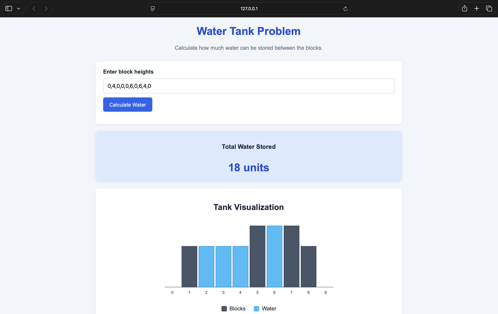
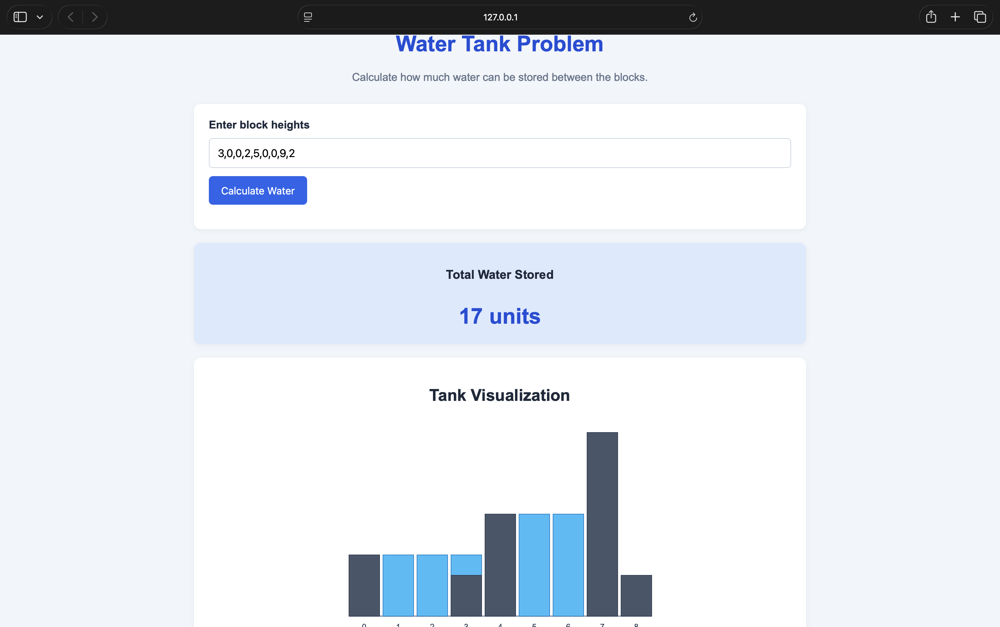
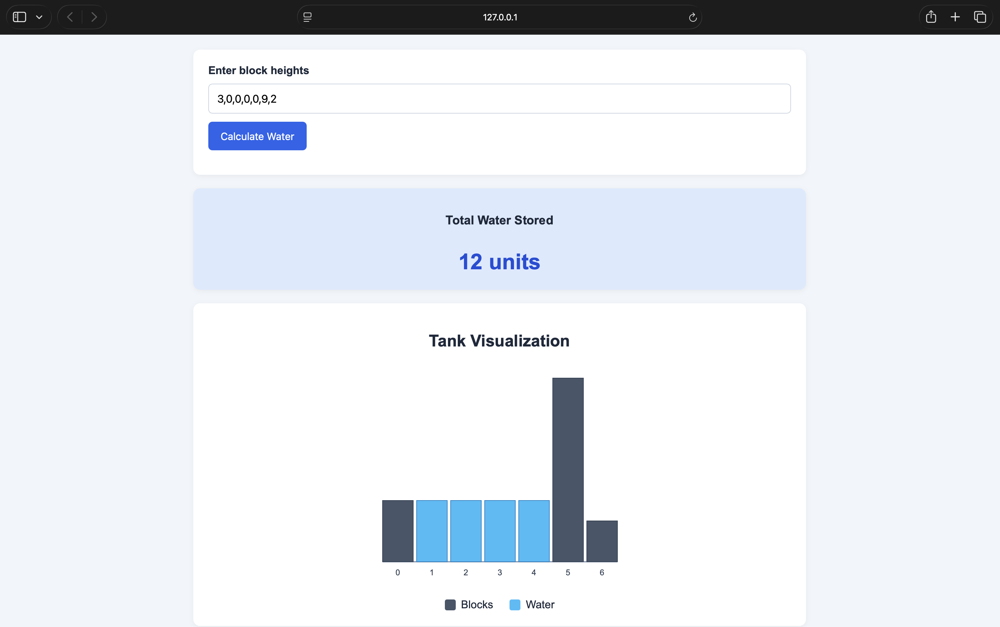

# Water Tank Problem — Water Trapping Visualizer

A simple web application built using **HTML, CSS, and Vanilla JavaScript** to calculate and visualize the amount of rainwater trapped between blocks of different heights.

## Overview

Given an array of non-negative integers representing block heights, the application calculates the total units of water that can be trapped between the blocks and displays the result using an SVG visualization.

### Example

**Input**
```text
[0, 4, 0, 0, 0, 6, 0, 6, 4, 0]
```

**Output**
```text
18 units
```

## Features

- Calculate the total trapped rainwater.
- Visualize blocks and trapped water using SVG.
- Display the water stored at each index.
- Accept custom block heights as comma-separated values.
- Validate user input and display error messages.
- Responsive and simple user interface.
- No external libraries or frameworks required.

## Technologies Used

- HTML5
- CSS3
- Vanilla JavaScript
- SVG (Scalable Vector Graphics)

## Project Structure

```text
water-tank-visualizer/
├── index.html
├── style.css
├── script.js
└── README.md
```

## How to Run

1. Clone the repository:

   ```bash
   git clone <your-repository-url>
   ```

2. Navigate to the project directory:

   ```bash
   cd water-tank-visualizer
   ```

3. Open `index.html` in your browser.

   Alternatively, open the project in VS Code and use the Live Server extension.

4. Enter block heights separated by commas and click **Calculate** to view the result.

## Algorithm

The solution uses the **Prefix Maximum and Suffix Maximum** approach.

For each index, the amount of water trapped depends on the tallest block to its left and the tallest block to its right.

### Steps

1. Create a prefix maximum array (`psum`) that stores the tallest block from the beginning up to each index.
2. Create a suffix maximum array (`ssum`) that stores the tallest block from each index to the end.
3. For every index, calculate the water level as the minimum of the two maximum heights.
4. Subtract the current block height from that water level to determine the trapped water.
5. Add the trapped water at every index to obtain the total.

**Formula**

```text
water[i] = min(psum[i], ssum[i]) - height[i]

totalWater = sum(water[i])
```

## Sample visualization





